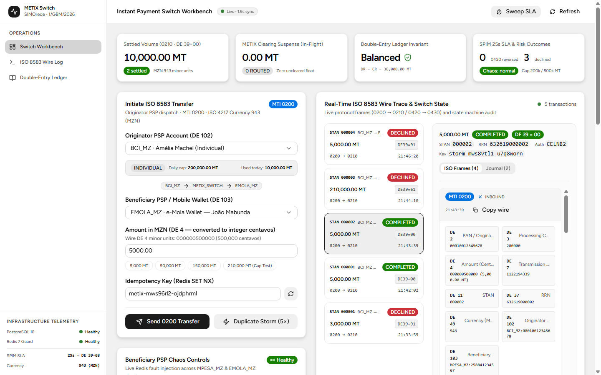
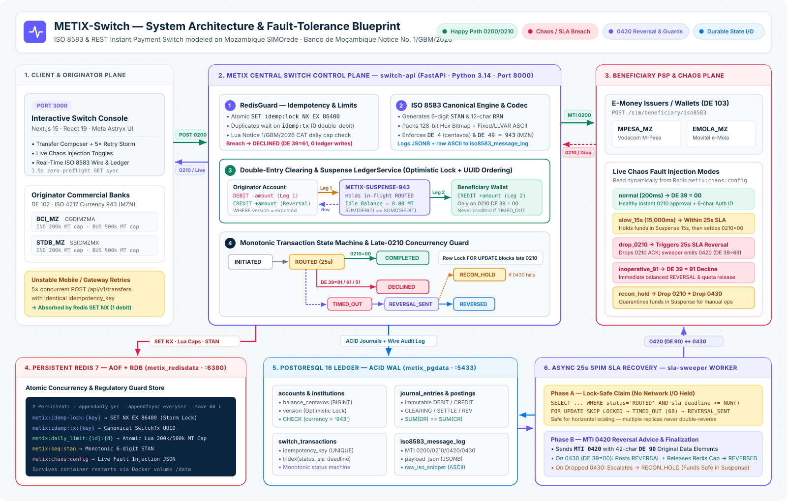
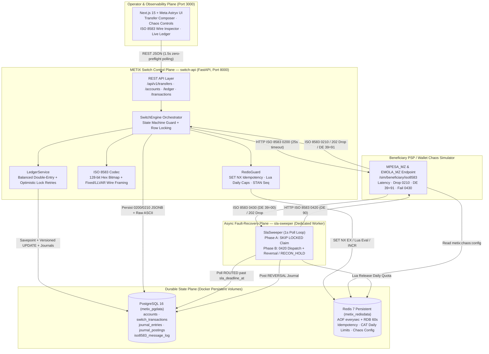
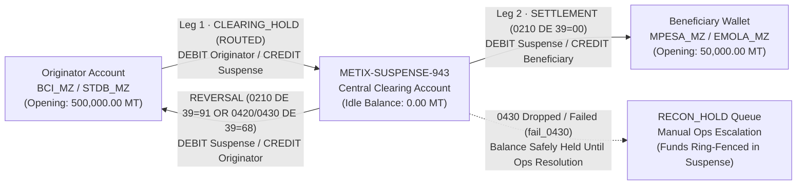
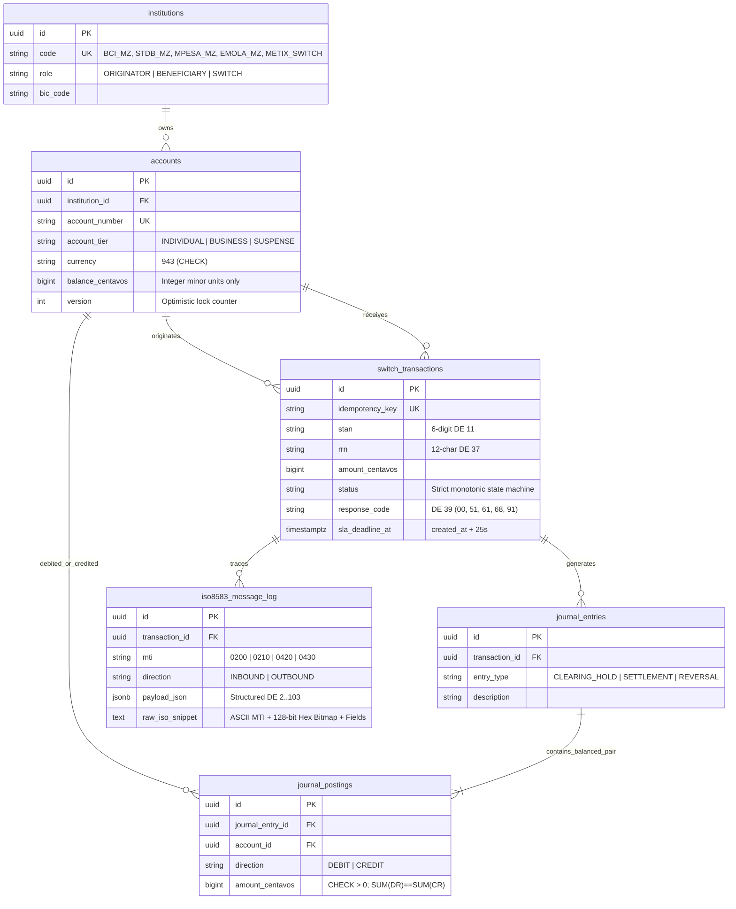
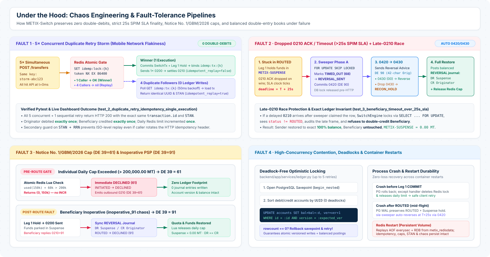
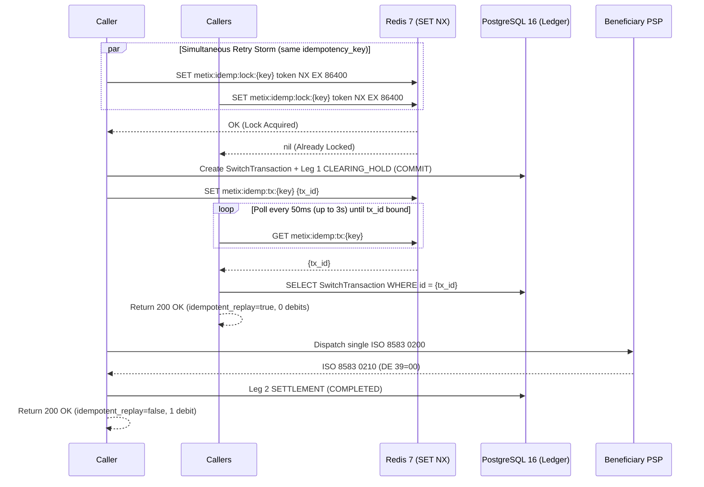
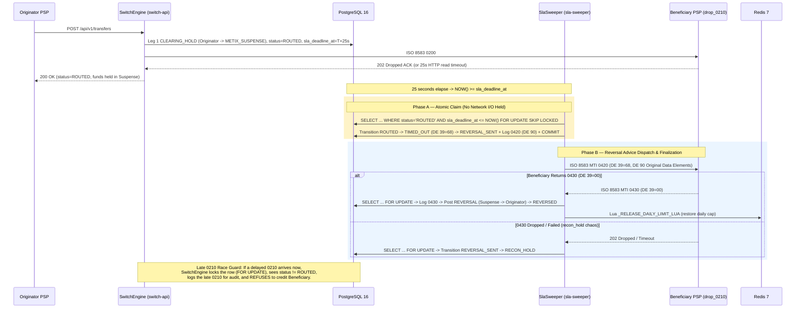
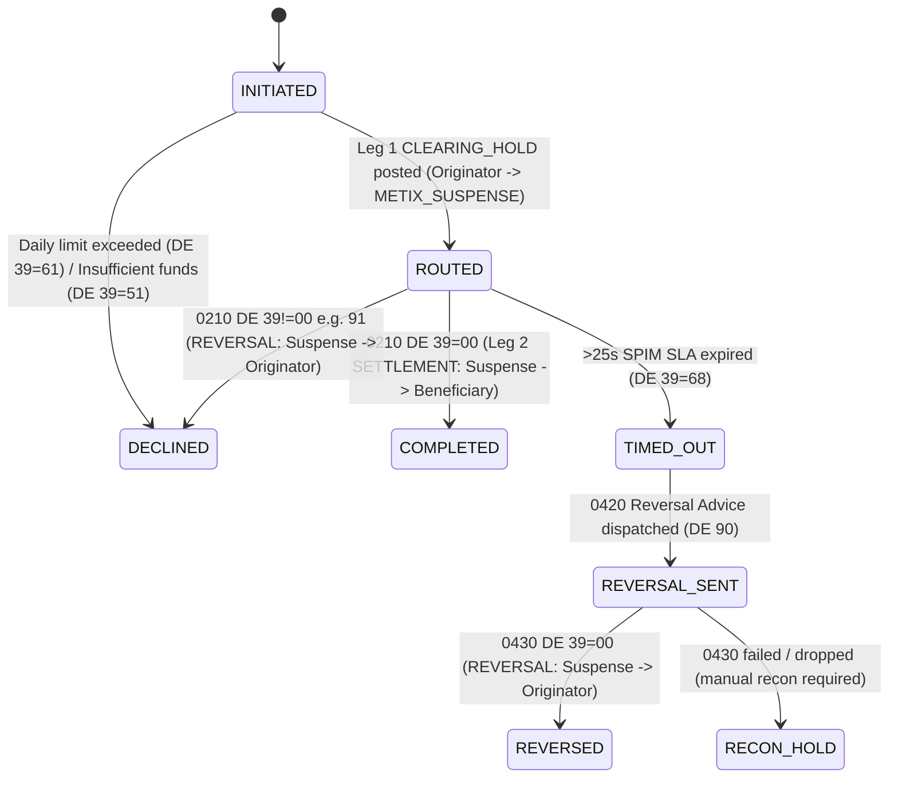

# METIX-Switch (`metix-switch-sim`)

**Fault-tolerant ISO 8583 & REST Instant Payment Switch simulator modeled on Mozambique’s METIX / SIMOrede infrastructure (Banco de Moçambique Notice No. 1/GBM/2026).**

[](https://www.python.org/)
[](https://fastapi.tiangolo.com/)
[](https://www.postgresql.org/)
[-DC382D?logo=redis&logoColor=white)](https://redis.io/)
[](https://nextjs.org/)
[](https://github.com/meta/astryx)

---

## 1. The Problem It Solves & Regulatory Alignment

In February 2026, **Banco de Moçambique** enacted **Notice No. 1/GBM/2026** (effective March 2, 2026), establishing the legal and operational framework for the **Mozambique Instant Payment System (SPIM / METIX)** under the National Payment System Law (Law No. 2/2008). Alongside the upgraded **SIMOrede** national switch—connecting commercial banks (`BCI`, `Standard Bank`, etc.) with E-Money Issuers (`M-Pesa`, `e-Mola`, `mKesh`)—cross-domain interoperable transfers in Mozambique grew from **244 transactions in 2022 to over 43 million annually**.

Transitioning from overnight batch clearing (ACH) to **24/7/365 real-time instant settlement** creates four acute distributed-systems failure modes that core banking and fintech middleware teams must survive without losing a single centavo:

| Real-World Payment Rail Problem | What Goes Wrong in Naive Implementations | How `metix-switch-sim` Solves It |
| :--- | :--- | :--- |
| **1. Timeout Ambiguity (25s SPIM SLA)** | Originator sends `0200`, beneficiary mobile wallet hangs or drops the `0210` ACK. Sender’s money vanishes into limbo or gets stuck indefinitely. | Two-leg **Clearing Suspense** accounting (`Originator → METIX_SUSPENSE`). A dedicated `sla-sweeper` worker detects `ROUTED` transfers exceeding `25s`, marks `TIMED_OUT` (`DE 39 = 68`), dispatches `MTI 0420` Reversal Advice (`DE 90`), and posts a balanced reversal restoring the sender’s exact balance. |
| **2. Mobile Retry Storms (Double-Debit Risk)** | Unstable 3G/4G networks cause mobile clients or PSP gateways to retry the same payment 3–5× concurrently, debiting the customer multiple times. | Atomic **Redis `SET ... NX EX`** idempotency locks keyed on `idempotency_key` and `STAN + RRN`. Concurrent and sequential retries resolve to the exact original `switch_transactions` record with **1 ledger execution and 0 double-debits**. |
| **3. Protocol Impedance Mismatch (ISO 8583 ↔ REST)** | Legacy core banking switches speak fixed/LLVAR **ISO 8583** wire frames (`MTI`, 128-bit hex bitmaps, `STAN`, `RRN`, `DE 39`), whereas modern PSP apps and wallets speak **JSON/REST**. | Canonical Pydantic v2 ISO 8583 codec translating REST transfer instructions into genuine ASCII wire frames (`0200`, `0210`, `0420`, `0430`) with 128-bit primary+secondary hex bitmaps, persisted alongside structured `JSONB` payloads in `iso8583_message_log`. |
| **4. Regulatory Ceilings & Ledger Drift** | Floating-point rounding errors, direct `UPDATE accounts SET balance = ...` mutations, or non-atomic limit checks allow overdrafts, unbalanced books, or breaches of central bank daily caps. | Strict integer **centavos** (`BIGINT`, ISO 4217 `943` MZN), **optimistic locking** (`accounts.version`), immutable double-entry `journal_entries` + `journal_postings` (`SUM(DEBIT) == SUM(CREDIT)`), and atomic **Redis Lua** daily counters enforcing **200,000.00 MT** (`INDIVIDUAL`) and **500,000.00 MT** (`BUSINESS`) caps (`DE 39 = 61`). |

---

## 2. Interactive Operator Dashboard Preview

Built on Meta’s **Astryx Design System** (`@astryxdesign/core`, `@astryxdesign/theme-neutral`) with a Stripe-inspired light financial infrastructure workspace:

### Switch Workbench & Real-Time ISO 8583 Wire Inspector


### Live Institution Balances, Notice No. 1/GBM/2026 Daily Caps & Double-Entry Journal


---

## 3. System Architecture Design



### 3.1 Layered Component & Network Architecture



### 3.2 Double-Entry Clearing & Suspense Money Flow

Funds never teleport directly from Originator to Beneficiary while an external PSP network call is in flight. Instead, every routed payment clears through `METIX-SUSPENSE-943` in two immutable, balanced legs so money is strictly conserved at every millisecond—even during network drops or container crashes:



### 3.3 PostgreSQL Ledger & Audit Schema (`erDiagram`)



### 3.4 Persistent Redis 7 Key Space

Redis runs with `--appendonly yes --appendfsync everysec --save 60 1` backed by Docker volume `metix_redisdata:/data`:

| Redis Key Pattern | Data Type / Command | TTL | Responsibility |
| :--- | :--- | :--- | :--- |
| `metix:idemp:lock:{idempotency_key}` | `SET ... NX EX` | `86,400s` (24h) | Atomic winner-takes-all concurrency lock preventing duplicate execution |
| `metix:idemp:tx:{idempotency_key}` | `SET ... EX` | `86,400s` (24h) | Maps `idempotency_key` → canonical `switch_transactions.id` for concurrent followers |
| `metix:idemp:stanrrn:{stan}:{rrn}` | `SET ... NX EX` | `86,400s` (24h) | Secondary protocol-level idempotency guard on ISO 8583 `STAN + RRN` |
| `metix:daily_limit:{account_id}:{YYYY-MM-DD}` | Atomic Lua (`INCRBY` / clamped decrement) | `172,800s` (48h) | Enforces Notice No. 1/GBM/2026 CAT daily cap (`20M` Individual / `50M` Business centavos) |
| `metix:seq:stan` | `INCR` (`% 1_000_000`) | Persistent | Monotonically sequenced 6-digit ISO 8583 STAN generator |
| `metix:chaos:config` | JSON string | Persistent | Shared live chaos preset read by `switch-api`, `beneficiary-sim`, and `sla-sweeper` |

---

## 4. Under the Hood: Fault Tolerance & Chaos Mechanics



### 4.1 How Concurrent Duplicate Retry Storms Are Absorbed (`5×` Simultaneous Requests)

When an unstable mobile network fires 5 identical `POST /api/v1/transfers` requests at the exact same millisecond, **only 1 caller acquires the Redis `SET NX` lock**; the other 4 never touch the ledger or call the beneficiary PSP:



### 4.2 How Dropped `0210` ACKs, 25s SPIM SLA Timeouts & Late `0210` Races Work

When `drop_0210` chaos is active (or a beneficiary PSP stalls beyond 25 seconds), the switch splits timeout recovery into **two isolated database transactions** so database row locks are never held across external HTTP calls:



### 4.3 Deadlock-Free Optimistic Locking in the Ledger

High-throughput payment switches experience heavy contention on shared accounts (especially `METIX-SUSPENSE-943` and high-volume corporate originator accounts). `backend/app/services/ledger.py` prevents both **lost balance updates** and **circular row-lock deadlocks**:

1. **Nested Savepoint (`BEGIN NESTED`):** Each retry attempt executes inside a PostgreSQL savepoint with `populate_existing=True` so stale ORM cache values are never trusted.
2. **Pre-Debit Solvency Check:** Non-suspense accounts verify `balance_centavos >= amount_centavos`; shortfalls abort immediately with `InsufficientFundsError` (`DE 39 = 51`) and release the Redis daily limit.
3. **Deterministic UUID Lock Ordering:** The debit account and credit account updates are sorted by `account.id` (`UUID`) before executing SQL `UPDATE`, making opposite-direction deadlocks mathematically impossible.
4. **Compare-and-Swap Version Check:**
   ```sql
   UPDATE accounts
   SET balance_centavos = balance_centavos + :delta,
       version = version + 1,
       updated_at = NOW()
   WHERE id = :account_id
     AND version = :expected_version;
   ```
   If `rowcount != 1` (a concurrent transaction modified the account first), the savepoint rolls back cleanly and retries (up to 5 attempts) before raising `OptimisticLockError`.

### 4.4 Crash Recovery & Failure-Point Guarantees

| Failure Point | What Happens Under the Hood | Financial State Guarantee |
| :--- | :--- | :--- |
| **`switch-api` crashes before Leg 1 commits** | PostgreSQL rolls back the open transaction. The `except` block deletes `metix:idemp:lock:{key}` and runs `_RELEASE_DAILY_LIMIT_LUA`. | **Zero debit**, daily cap restored, client can safely retry with the same key. |
| **`switch-api` crashes after `ROUTED` commits (before `0200` reaches beneficiary)** | `SwitchTransaction` is durably persisted in PostgreSQL as `ROUTED` with `sla_deadline_at = T + 25s` and funds in `METIX_SUSPENSE`. | Within 25s, `sla-sweeper` automatically claims the row, sends `0420`, and restores 100% of sender funds. |
| **Multiple `sla-sweeper` replicas run simultaneously** | Phase A queries `FOR UPDATE SKIP LOCKED` and commits `REVERSAL_SENT` before making HTTP calls. | **Zero duplicate `0420` reversals**; each expired row is claimed by exactly one worker. |
| **Beneficiary drops both `0210` and `0430` (`recon_hold`)** | Sweeper transitions `REVERSAL_SENT → RECON_HOLD` instead of blindly crediting the sender (since beneficiary settlement state is unknown). | Funds stay auditable and ring-fenced in `METIX_SUSPENSE` for operations reconciliation. |
| **Redis container restarts (`docker restart metix-redis`)** | Redis replays `/data/appendonlydir` (`AOF everysec`) + RDB snapshot from volume `metix_redisdata`. | Idempotency keys, daily CAT limits, STAN counter, and chaos config survive intact. |

### 4.5 Strict Transaction State Machine (`switch_transactions.status`)

Terminal states (`COMPLETED`, `DECLINED`, `REVERSED`, `RECON_HOLD`) are mathematically monotonic—attempting any backward or illegal transition raises `InvalidStateTransitionError`.



### 4.6 Chaos Engineering Matrix

The Beneficiary PSP Simulator (`POST /sim/beneficiary/chaos`) and dashboard Chaos Controls inject faults globally or scoped to a single wallet (`MPESA_MZ` or `EMOLA_MZ`):

| Chaos / Stress Scenario | Injected Fault | Wire Trace Sequence | `DE 39` | Final State | Double-Entry Ledger & Balances | Redis Daily Quota |
| :--- | :--- | :--- | :---: | :--- | :--- | :--- |
| **`normal`** *(default)* | `200ms` latency, `drop_0210=false` | `0200 IN → 0200 OUT → 0210 IN → 0210 OUT` | `00` | `COMPLETED` | 2 balanced entries (`CLEARING_HOLD` + `SETTLEMENT`). Originator `-amt`, Beneficiary `+amt`, Suspense `0.00 MT`. | Consumed (`+amt`) |
| **`slow_15s`** | `15,000ms` latency (< 25s SLA) | `0200 IN → 0200 OUT → (15s) → 0210 IN → 0210 OUT` | `00` | `COMPLETED` | Funds sit in `METIX_SUSPENSE` during the 15s wait, then settle cleanly before the 25s SLA deadline expires. | Consumed (`+amt`) |
| **`drop_0210`** | Beneficiary accepts `0200` & drops `0210` ACK | `0200 IN → 0200 OUT → (>25s) → 0420 OUT → 0430 IN` | `68` | `REVERSED` | Stays `ROUTED` (funds in Suspense) until `sla_deadline_at`. `sla-sweeper` posts `REVERSAL` restoring 100% of sender’s balance; Suspense returns to `0.00 MT`. | Reserved then **released** (`-amt`) |
| **`inoperative_91`** | Beneficiary returns `DE 39 = 91` | `0200 IN → 0200 OUT → 0210 IN (91) → 0210 OUT (91)` | `91` | `DECLINED` | `CLEARING_HOLD` immediately offset by balanced `REVERSAL`. Sender balance unchanged; Suspense `0.00 MT`. | Reserved then **released** (`-amt`) |
| **`recon_hold`** | Drops `0210` AND drops `0430` reversal ACK | `0200 IN → 0200 OUT → (>25s) → 0420 OUT (no 0430)` | `68` | `RECON_HOLD` | Escalates from `REVERSAL_SENT → RECON_HOLD`. Funds remain safely ring-fenced in `METIX_SUSPENSE` awaiting manual ops reconciliation (never silently lost). | Held pending recon |
| **Duplicate Retry Storm (`5×`)** | 5 concurrent `POST /api/v1/transfers` with identical `idempotency_key` | 1× canonical trace (`0200 → 0210`) | `00` | `COMPLETED` | **1 fresh execution + 4 Redis `SET NX` replays.** Originator debited exactly **once**; all 5 HTTP callers receive the identical transaction UUID & STAN. | Consumed **once** |
| **Individual Cap Breach (`> 200k MT`)** | Cumulative CAT daily volume exceeds `200,000.00 MT` on `INDIVIDUAL` account | `0200 IN → 0210 OUT (61)` *(never routed)* | `61` | `DECLINED` | **0 journal entries** written; balance & optimistic lock `version` untouched. | Unchanged (Lua script aborts atomically) |

---

## 5. Core Engineering Invariants

All invariants are codified in [GEMINI.md](GEMINI.md) and enforced at both database constraint and application layers:

1. **Minor Units Only (ISO 4217 `943` MZN):** Every monetary column is PostgreSQL `BIGINT` (`balance_centavos`, `amount_centavos`) and Python `int` (`1.00 MT = 100 centavos`). Zero `float` arithmetic is used for money.
2. **Double-Entry Clearing & Suspense Immutability:** `accounts.balance_centavos` is never mutated directly. Every balance movement calls `post_balanced_journal(...)`, writing one `journal_entries` header and two `journal_postings` rows where `SUM(DEBIT) == SUM(CREDIT)` inside a single PostgreSQL transaction.
3. **Optimistic Locking (`accounts.version`):** Every balance update checks and increments `version` (`WHERE id = :id AND version = :expected_version`) in deterministic UUID order.
4. **Deterministic Redis Idempotency (`SET NX EX`):** Keyed on `idempotency_key` and `STAN + RRN`, preventing double-debits under concurrent retry storms.
5. **Notice No. 1/GBM/2026 Daily Limits (CAT `Africa/Maputo`):** Atomic Redis Lua scripts cap daily outbound volume at **`200,000.00 MT`** (`INDIVIDUAL`) and **`500,000.00 MT`** (`BUSINESS`), returning **`DE 39 = 61`** on breach without touching the ledger.
6. **Persistent Backing Stores:** PostgreSQL (`metix_pgdata`) and Redis (`metix_redisdata`, AOF `everysec` + RDB) preserve state across container restarts.

---

## 6. ISO 8583 Wire Specification

Every inbound and outbound frame is logged to `iso8583_message_log` in both structured `JSONB` (`payload_json`) and packed ASCII wire format (`raw_iso_snippet`):

```text
0200 F2200000080080000000000006000000 1400010012345678 280000 000000500000 ...
│    │                                │                │      └─ DE 4: 5,000.00 MT (12-digit centavos)
│    │                                │                └─ DE 3: Processing Code (280000 P2P Instant)
│    │                                └─ DE 2: LLVAR (len 14) Originator Account
│    └─ 128-bit Primary + Secondary Hex Bitmap (Bit 1 set because DE 102/103 > 64)
└─ MTI 0200 (Financial Request)
```

| Data Element | Format | Required On | Purpose in METIX / SIMOrede |
| :--- | :--- | :--- | :--- |
| **MTI** | 4-char fixed | All | `0200` Request · `0210` Response · `0420` Reversal Advice · `0430` Reversal Response |
| **DE 2** | LLVAR (6–19) | All | Originator PAN / Account Identifier |
| **DE 3** | 6-digit fixed | All | `280000` (Instant P2P Transfer) · `280020` (Reversal) |
| **DE 4** | 12-digit fixed | All | Transaction Amount in integer **centavos** (zero-padded, e.g. `000000500000` = `5,000.00 MT`) |
| **DE 7** | 10-digit fixed | All | UTC Transmission Date & Time (`MMDDhhmmss`) |
| **DE 11** | 6-digit fixed | All | Systems Trace Audit Number (`STAN`, monotonically sequenced via Redis) |
| **DE 37** | 12-char fixed | All | Retrieval Reference Number (`RRN`, format `YDDDHH + STAN`) |
| **DE 38** | 6-char fixed | `0210` (`00`) | Authorization Identification Response (6-char alphanumeric) |
| **DE 39** | 2-char fixed | `0210`, `0420`, `0430` | Response Code: `00` Approved · `51` Insufficient Funds · `61` Exceeds Daily Cap · `68` 25s SLA Timeout · `91` Issuer Inoperative |
| **DE 49** | 3-char fixed | All | Currency Code strictly validated as **`943`** (MZN — Mozambican Metical) |
| **DE 90** | 42-char fixed | `0420`, `0430` | Original Data Elements (`orig_mti(4) + orig_stan(6) + orig_de7(10) + acquirer(11) + forwarding(11)`) |
| **DE 102** | LLVAR | All | Originator Account ID (`INSTITUTION_CODE:ACCOUNT_NUMBER`) |
| **DE 103** | LLVAR | All | Beneficiary Account ID (`INSTITUTION_CODE:ACCOUNT_NUMBER`) |

---

## 7. Automated Test Suite (`pytest`) — What Every Test Verifies

The integration suite in [`backend/tests/test_switch_integration.py`](backend/tests/test_switch_integration.py) executes against **real PostgreSQL 16 and Redis 7 instances** (truncating & re-seeding DB tables and flushing Redis DB `1` per test for deterministic isolation):

| # | Test Name | Chaos / Condition | Exact Assertions Verified |
| :---: | :--- | :--- | :--- |
| 1 | `test_iso8583_wire_codec_round_trip` | Unit — Protocol Codec | Encodes `0200` and `0420` (with 42-char `DE 90`) into ASCII wire frames with 128-bit hex bitmaps and asserts lossless round-trip via `decode_raw_iso(...)`. |
| 2 | `test_terminal_states_never_transition_backward` | Unit — State Machine | Verifies `COMPLETED`, `DECLINED`, `REVERSED`, and `RECON_HOLD` all raise `InvalidStateTransitionError` on any attempted transition. |
| 3 | `test_1_happy_path_0200_to_0210_balanced_double_entry` | `normal` (`10ms`) | Sends `7,500.00 MT` (`BCI_MZ → MPESA_MZ`). Asserts `COMPLETED`, `DE 39 = 00`, 6-char `auth_id`, 4 wire logs (`0200`/`0210` IN+OUT, `DE 49 = 943`), 2 balanced entries (`CLEARING_HOLD` + `SETTLEMENT`), exact final centavo balances, `METIX_SUSPENSE == 0`, incremented lock versions (`v2`/`v3`), and global ledger `is_balanced == True`. |
| 4 | `test_2_duplicate_retry_idempotency_single_execution` | **5× Concurrent Storm + 1 Sequential Retry** | Fires 5 simultaneous `POST /api/v1/transfers` (`asyncio.gather`) + 1 follow-up request with identical `idempotency_key`. Asserts all 6 return the **exact same transaction ID**, `fresh_count == 1`, `idempotent_replay == True` on duplicates, and originator is debited **exactly once**. |
| 5 | `test_3_beneficiary_timeout_over_25s_sla_triggers_0420_reversal` | **`drop_0210` + >25s SLA Expiry** | Enables `drop_0210`, sends `12,000.00 MT`, confirms transaction holds in `ROUTED` with `12,000.00 MT` in `METIX_SUSPENSE`. Advances past 25s SLA deadline (`-26s`), invokes `SlaSweeper.sweep_once()`, and asserts `REVERSED`, `DE 39 = 68`, `0420` (42-char `DE 90`) + `0430` wire logs, no `0210` log, balanced `REVERSAL` entry, and **100% sender balance restoration** (`500,000.00 MT`) with `METIX_SUSPENSE == 0`. |
| 6 | `test_4_individual_daily_limit_200k_mt_notice_1_gbm_2026` | **Notice 1/GBM/2026 Daily Cap** | Approves `150,000.00 MT` on `INDIVIDUAL` account (`COMPLETED`), then attempts `60,000.00 MT` (cumulative `210,000.00 MT > 200,000.00 MT`). Asserts second transfer is `DECLINED`, `DE 39 = 61`, outbound `0210` carries `61`, `journal_entries == []`, and balance reflects only the first transfer. |
| 7 | `test_5_beneficiary_inoperative_de39_91_reverses_clearing_hold` | **`inoperative_91` (`DE 39 = 91`)** | Enables `inoperative_91`, sends `3,000.00 MT`, and asserts `DECLINED`, `DE 39 = 91`, balanced `CLEARING_HOLD` + `REVERSAL` postings, originator balance fully intact (`500,000.00 MT`), and `METIX_SUSPENSE == 0`. |

Verified run output:
```text
tests/test_switch_integration.py::test_iso8583_wire_codec_round_trip PASSED                      [ 14%]
tests/test_switch_integration.py::test_terminal_states_never_transition_backward PASSED          [ 28%]
tests/test_switch_integration.py::test_1_happy_path_0200_to_0210_balanced_double_entry PASSED    [ 42%]
tests/test_switch_integration.py::test_2_duplicate_retry_idempotency_single_execution PASSED     [ 57%]
tests/test_switch_integration.py::test_3_beneficiary_timeout_over_25s_sla_triggers_0420_reversal PASSED [ 71%]
tests/test_switch_integration.py::test_4_individual_daily_limit_200k_mt_notice_1_gbm_2026 PASSED [ 85%]
tests/test_switch_integration.py::test_5_beneficiary_inoperative_de39_91_reverses_clearing_hold PASSED [100%]
========================================= 7 passed in 1.42s ==========================================
```

---

## 8. Seeded Mozambican Institutions & Accounts

On startup (or via `POST /api/v1/seed`), the database idempotently seeds 5 institutions and 7 accounts:

| Institution | Role | BIC | Account Number | Account Holder | Tier | Daily Cap | Opening Balance |
| :--- | :--- | :--- | :--- | :--- | :--- | ---: | ---: |
| `METIX_SWITCH` | `SWITCH` | `SIMOMZMA` | `METIX-SUSPENSE-943` | METIX Clearing Suspense (MZN) | `SUSPENSE` | — | `0.00 MT` |
| `BCI_MZ` | `ORIGINATOR` | `CGDIMZMA` | `00010012345678` | Amélia Machel (Individual) | `INDIVIDUAL` | `200,000.00 MT` | `500,000.00 MT` |
| `BCI_MZ` | `ORIGINATOR` | `CGDIMZMA` | `00010087654321` | Maputo Logistics Lda (Business) | `BUSINESS` | `500,000.00 MT` | `1,500,000.00 MT` |
| `STDB_MZ` | `ORIGINATOR` | `SBICMZMX` | `00030055443322` | Carlos Mondlane (Individual) | `INDIVIDUAL` | `200,000.00 MT` | `400,000.00 MT` |
| `STDB_MZ` | `ORIGINATOR` | `SBICMZMX` | `00030099887766` | Beira Port Trading SA (Business) | `BUSINESS` | `500,000.00 MT` | `2,000,000.00 MT` |
| `MPESA_MZ` | `BENEFICIARY` | `MPESMZMA` | `258841234567` | M-Pesa Wallet — Rosa Sitoe | `INDIVIDUAL` | — | `50,000.00 MT` |
| `EMOLA_MZ` | `BENEFICIARY` | `EMOLMZMA` | `258869876543` | e-Mola Wallet — João Mabunda | `INDIVIDUAL` | — | `35,000.00 MT` |

---

## 9. API Reference

| Method | Endpoint | Description |
| :--- | :--- | :--- |
| `GET` | `/health` | Verifies live PostgreSQL 16 and Redis 7 connectivity |
| `POST` | `/api/v1/transfers` | Originator PSP initiates an instant transfer (`0200`) with Redis idempotency & daily limit checks |
| `GET` | `/api/v1/transactions` | Lists recent `switch_transactions` with nested ISO 8583 message traces and journal postings |
| `GET` | `/api/v1/transactions/{id}` | Full transaction detail, decoded wire frames, and double-entry postings |
| `GET` | `/api/v1/accounts` | Live account balances, optimistic lock `version`, and Notice No. 1/GBM/2026 Redis daily usage |
| `GET` | `/api/v1/ledger` | Global double-entry integrity check (`SUM(DEBIT) == SUM(CREDIT)`), suspense float, and journal log |
| `POST` | `/api/v1/sweeper/run` | Manually triggers one immediate 25s SPIM SLA sweep cycle |
| `POST` | `/api/v1/seed` | Idempotently seeds institutions and sample accounts |
| `GET` / `POST` | `/sim/beneficiary/chaos` | Reads or updates live chaos controls (`normal`, `slow_15s`, `drop_0210`, `inoperative_91`, `recon_hold`) |
| `POST` | `/sim/beneficiary/iso8583` | Beneficiary PSP ISO 8583 receiver (`0200 → 0210` and `0420 → 0430`) |

---

## 10. Quickstart

### Prerequisites
* **Docker** & **Docker Compose**
* **Python 3.14+** with [`uv`](https://docs.astral.sh/uv/) (for local backend lint & pytest runs)
* **[`bun`](https://bun.sh/)** (for local frontend development & builds)

### Run the Full 5-Service Stack via Docker Compose

```bash
git clone https://github.com/<your-username>/metix-switch-sim.git
cd metix-switch-sim
docker compose up -d --build --wait
```

Once healthy:
* **Interactive Dashboard (Meta Astryx × Stripe UI):** http://localhost:3000
* **FastAPI Switch & OpenAPI Swagger Docs:** http://localhost:8000/docs
* **PostgreSQL 16 (host port):** `localhost:5433` (user `metix`, db `metix_switch`, volume `metix_pgdata`)
* **Persistent Redis 7 (host port):** `localhost:6380` (`AOF + RDB`, volume `metix_redisdata`)

> Host ports `5433` and `6380` are intentionally mapped off defaults (`5432`/`6379`) to avoid colliding with local PostgreSQL/Redis installations while keeping standard internal Docker DNS (`postgres:5432`, `redis:6379`).

### Local Verification & Development Commands

```bash
# 1. Start backing infrastructure (PostgreSQL 16 + Persistent Redis 7)
docker compose up -d --wait postgres redis

# 2. Sync Python 3.14 environment, lint, format-check, and run all 7 pytest tests
uv --directory backend sync --python 3.14
uv --directory backend run ruff check .
uv --directory backend run ruff format --check .
uv --directory backend run pytest -v

# 3. Install & build Next.js + Astryx frontend with Bun
bun install --cwd frontend
bun run --cwd frontend build
```

---

## 11. Repository Structure

```text
metix-switch-sim/
├── GEMINI.md                              # Non-negotiable architectural & financial invariants
├── docker-compose.yml                     # 5-service stack (postgres, persistent redis, switch-api, sla-sweeper, frontend)
├── docs/
│   └── images/                            # Architecture diagrams & live dashboard screenshots
│       ├── architecture_overview.svg
│       ├── chaos_fault_tolerance_flow.svg
│       ├── dashboard_workbench.png
│       └── dashboard_ledger.png
├── backend/
│   ├── Dockerfile                         # Python 3.14 + uv container image
│   ├── pyproject.toml                     # Dependencies, ruff & pytest-asyncio config
│   ├── app/
│   │   ├── config.py                      # Settings (25s SLA, 200k/500k MT caps, CAT timezone)
│   │   ├── main.py                        # FastAPI lifespan, CORS, router mounts
│   │   ├── db/
│   │   │   ├── models.py                  # SQLAlchemy 2.x ledger, ISO log & strict state machine
│   │   │   ├── session.py                 # Async engine & session factory
│   │   │   └── seed.py                    # Idempotent Mozambican PSP & wallet seed data
│   │   ├── iso8583/
│   │   │   ├── models.py                  # Canonical Pydantic v2 ISO 8583 message schema
│   │   │   └── codec.py                   # 128-bit bitmap ASCII encoder/decoder & builders
│   │   ├── services/
│   │   │   ├── ledger.py                  # Optimistic-locked balanced double-entry engine
│   │   │   ├── redis_guard.py             # Atomic SET NX idempotency & Lua daily limit scripts
│   │   │   ├── chaos.py                   # Shared Redis chaos configuration store
│   │   │   └── switch_engine.py           # Central METIX router & 0200/0210 orchestration
│   │   ├── api/
│   │   │   ├── schemas.py                 # Pydantic response/request DTOs
│   │   │   ├── switch_routes.py           # Switch REST API & ledger/account telemetry
│   │   │   └── beneficiary_sim.py         # MPESA_MZ / EMOLA_MZ chaos simulator
│   │   └── workers/
│   │       └── sla_sweeper.py             # Dedicated 25s SPIM SLA reversal worker (0420/0430)
│   └── tests/
│       ├── conftest.py                    # Real PostgreSQL & Redis async test fixtures
│       └── test_switch_integration.py     # 7 unit & integration tests (all 4 mandatory + DE 39=91)
└── frontend/
    ├── Dockerfile                         # Multi-stage oven/bun Next.js production image
    ├── package.json                       # Next.js 15, React 19, @astryxdesign/core, Tailwind v4
    └── src/
        ├── app/                           # App Router layout, page, Astryx + Stripe CSS tokens
        ├── lib/                           # Typed API client & centavo/MZN formatting utilities
        └── components/                    # SwitchDashboard, TransferComposer, ChaosControlPanel,
                                           # IsoWireInspector, LedgerBalancesPanel, AstryxProvider
```
