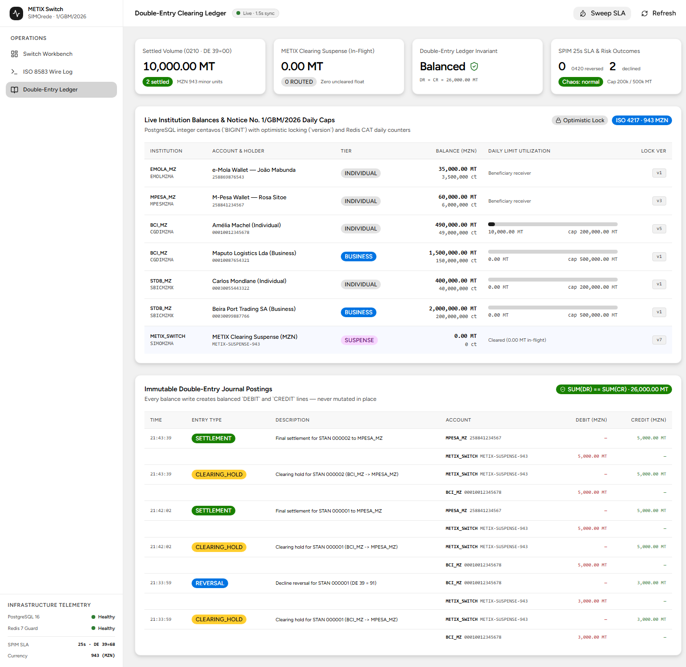
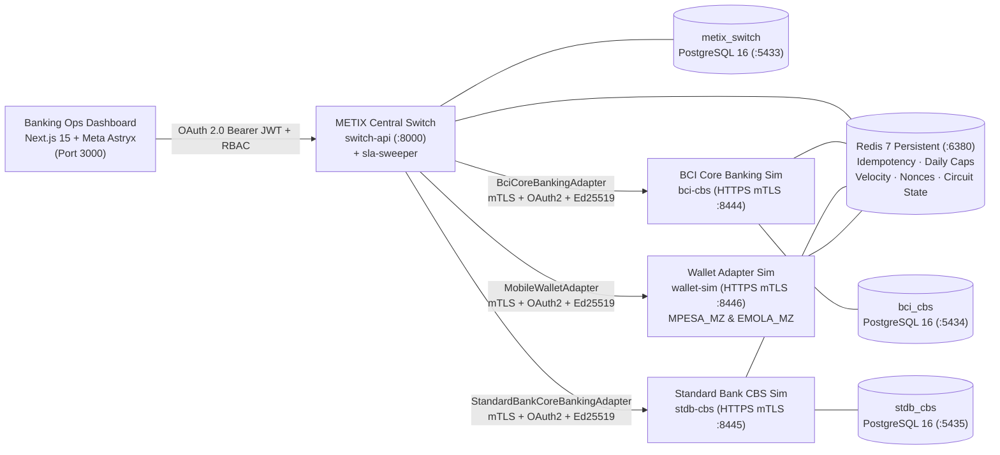
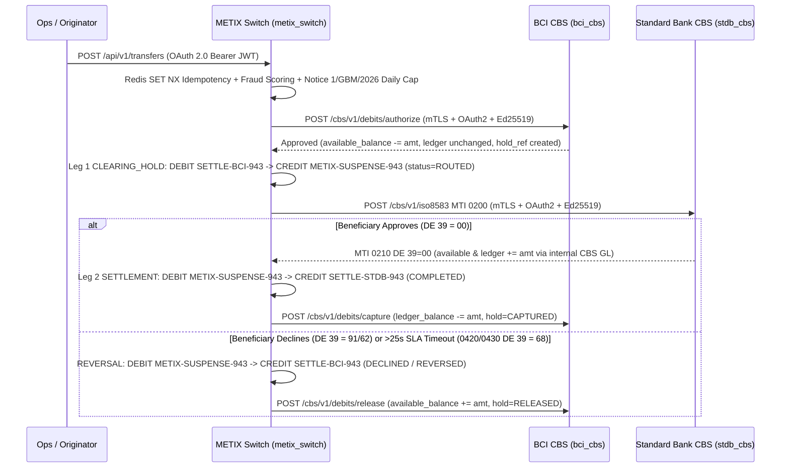
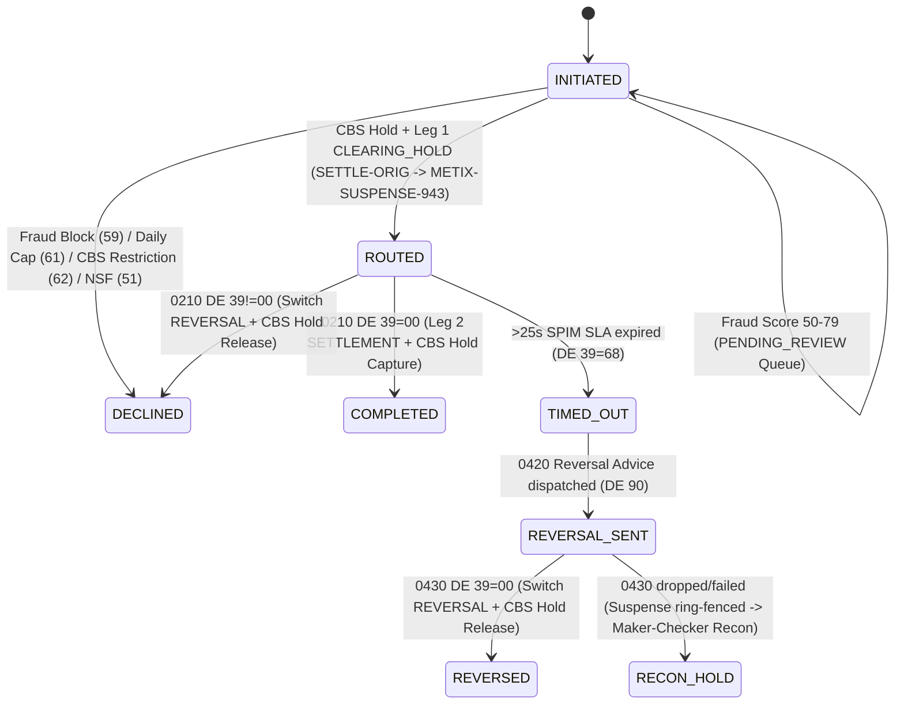

# METIX-Switch (`metix-switch-sim`)

**Multi-service ISO 8583 & REST Interbank Instant Payment Switch, Independent Core Banking Simulators (BCI & Standard Bank), Multilateral Net Settlement, 3-Way Reconciliation, Fraud Monitoring, and Enterprise Security platform modeled on Mozambique’s METIX / SIMOrede infrastructure (Banco de Moçambique Notice No. 1/GBM/2026).**

[](https://www.python.org/)
[](https://fastapi.tiangolo.com/)
[-4169E1?logo=postgresql&logoColor=white)](https://www.postgresql.org/)
[-DC382D?logo=redis&logoColor=white)](https://redis.io/)
[](https://datatracker.ietf.org/doc/html/rfc8705)
[](https://nextjs.org/)
[](https://github.com/meta/astryx)

---

## 1. Problem Domain & Regulatory Alignment

In February 2026, **Banco de Moçambique** enacted **Notice No. 1/GBM/2026** (effective March 2, 2026), establishing the legal and operational framework for the **Mozambique Instant Payment System (SPIM / METIX)** under the National Payment System Law (Law No. 2/2008). Alongside the upgraded **SIMOrede** national switch—connecting commercial banks (`BCI`, `Standard Bank`) and E-Money Issuers (`M-Pesa`, `e-Mola`)—interoperable real-time transfers require strict isolation between participant core banking ledgers and the central clearing switch.

| Real-World Interbank Payment Problem | How `metix-switch-sim` Solves It |
| :--- | :--- |
| **1. Bank Core Isolation (No Shared Customer DB)** | **BCI Core Banking (`bci-cbs` + `bci_cbs`)** and **Standard Bank Core Banking (`stdb-cbs` + `stdb_cbs`)** run as independent services with separate PostgreSQL 16 databases, Available vs. Ledger balances, earmark holds, internal double-entry GLs, and AES-256-GCM encrypted PII. **METIX Switch (`metix_switch`)** owns only clearing suspense and participant settlement accounts and talks to banks exclusively through **Bank Integration Adapters**. |
| **2. Timeout Ambiguity (25s SPIM SLA)** | Originator CBS earmarks `available_balance` while Switch posts Leg 1 `CLEARING_HOLD` (`SETTLE-* → METIX-SUSPENSE-943`). If `0210` is dropped past `25s`, the `sla-sweeper` worker dispatches `MTI 0420` (`DE 90`), posts a balanced reversal, releases Redis daily quota, and releases the Originator CBS hold. |
| **3. Mobile Retry Storms (Double-Debit Risk)** | Atomic **Redis `SET ... NX EX`** idempotency locks (`idempotency_key` + `STAN + RRN`) guarantee `5×` concurrent retry storms execute **once** across both Switch and CBS ledgers. |
| **4. Multilateral Settlement & Liquidity Risk** | Live **Multilateral Net Settlement (MNS)** calculates zero-sum net debit/credit positions ($\sum \text{net} = 0$), verifies intraday liquidity/reserve floors, supports liquidity-shortfall failure simulation + BM RTGS top-ups, and generates **Ed25519-signed settlement reports**. |
| **5. Inter-System Discrepancies & Suspense Float** | Automated **3-Way Financial Reconciliation** compares `metix_switch`, `bci_cbs`, and `stdb_cbs` to detect missing postings, orphans, duplicates, stale holds, and aged suspense—resolved strictly via **4-Eyes Maker-Checker** adjustments (`checker_id != maker_id`). |
| **6. Real-Time Fraud & Enterprise Security** | Pre-route **Fraud Scoring (`0–100`)** (Redis velocity bursts, structuring, fan-out, rapid `A → B → A` round-trips) with Analyst Review Queue, backed by **strict X.509 mTLS**, **OAuth 2.0 + RBAC**, **Ed25519 payload signatures with nonce replay guards**, and a **SHA-256 hash-chained immutable audit log**. |

---

## 2. Live End-to-End Walkthrough Recordings & Dashboard Preview

### End-to-End Browser Verification Recordings

Recorded live against the full 10-container mTLS Docker stack on `http://localhost:3000`:

| Part | Walkthrough Covered | Video File |
| :---: | :--- | :--- |
| **Part 1** | Live mTLS Bank Connectivity (`BCI_MZ`, `STDB_MZ`, `MPESA_MZ`, `EMOLA_MZ`), Bidirectional `BCI ↔ Standard Bank` `0200 → 0210` Transfer, ISO 8583 Wire Inspector & `5×` Duplicate Retry Storm | [`docs/recordings/recording.mp4`](docs/recordings/recording.mp4) *(5.7 MB)* |
| **Part 2** | Independent Core Banking Simulators (`bci_cbs` & `stdb_cbs` Available vs. Ledger balances, `AES-256-GCM PII`), Switch Double-Entry Ledger (`SUM(DR) == SUM(CR)`), Multilateral Net Settlement (`Σ Net = 0.00 MT`), Liquidity Shortfall Failure Simulation & Ed25519 Signed Report Verification | [`docs/recordings/recording_2.mp4`](docs/recordings/recording_2.mp4) *(11.0 MB)* |
| **Part 3** | 3-Way Financial Reconciliation (`ORPHAN_CBS_POSTING` → `MISSING_IN_SWITCH`), 4-Eyes Maker-Checker Approval (`ops.maker` → `ops.checker`), Fraud Detection Round-Trip Review Queue & Analyst Release (`fraud.analyst`), mTLS X.509 PKI Inventory & SHA-256 Audit Chain Verification | [`docs/recordings/recording_3.mp4`](docs/recordings/recording_3.mp4) *(35.8 MB)* |

<details>
<summary><strong>Click to expand inline video players</strong></summary>

#### Part 1 — Connectivity, Interbank Transfer & 5× Idempotency Storm
<video src="docs/recordings/recording.mp4" controls width="100%"></video>

#### Part 2 — Core Banking Simulators, Double-Entry Ledger & Multilateral Net Settlement
<video src="docs/recordings/recording_2.mp4" controls width="100%"></video>

#### Part 3 — 3-Way Reconciliation, Maker-Checker, Fraud Queue & SHA-256 Audit Chain
<video src="docs/recordings/recording_3.mp4" controls width="100%"></video>

</details>

### Dashboard Screenshots




---

## 3. Multi-Service System Architecture



### 3.1 Two-Tier Clearing & Core Banking Money Flow

Customer accounts never live in the Switch database. Instead, every interbank transfer coordinates **Available vs. Ledger balances** in the participant CBS databases alongside **Participant Settlement & Suspense** double-entry legs in `metix_switch`:



### 3.2 Strict Transaction State Machine (`switch_transactions.status`)

Terminal states (`COMPLETED`, `DECLINED`, `REVERSED`, `RECON_HOLD`) are strictly absorbing (`InvalidStateTransitionError` on any backward transition):



---

## 4. Enterprise Capabilities Overview

### 4.1 Independent Core Banking Simulators (`backend/cbs/`)
- Two completely separate FastAPI services (`bci-cbs`, `stdb-cbs`) with separate PostgreSQL 16 databases (`bci_cbs`, `stdb_cbs`).
- **Available vs. Ledger Balances**: outbound authorizations decrement `available_balance_centavos` and create a `cbs_holds` earmark; `ledger_balance_centavos` only decrements on `capture` via balanced internal GL postings (`cbs_journal_entries` / `cbs_journal_postings`).
- **Account Restrictions & Limits**: enforces `ACTIVE`, `PND` (Post No Debit), `PNC` (Post No Credit), `FROZEN`, `CLOSED` (`DE 39 = 62`), plus per-transaction and daily CBS limits (`DE 39 = 61`).
- **Encrypted PII at Rest**: `cbs_accounts.holder_name_enc` stores **AES-256-GCM** authenticated ciphertext (`enc:v1:<nonce>:<ciphertext>`) alongside HMAC-SHA256 blind indexes and masked display names.

### 4.2 Interbank Clearing & Multilateral Net Settlement (`backend/app/services/settlement.py`)
- Computes live multilateral net positions across `BCI_MZ`, `STDB_MZ`, `MPESA_MZ`, and `EMOLA_MZ` proving $\sum \text{net\_position\_centavos} = 0$.
- Tracks participant settlement balances, minimum reserve floors, collateral, and net debit caps (`participant_liquidity_profiles`).
- Supports **Settlement Failure Simulation** (liquidity shortfall → `FAILED` cycle + `CRITICAL` system alert), **BM RTGS Liquidity Top-Up** (balanced double-entry journal from `BM-RTGS-TREASURY-943`), and **Ed25519-signed Settlement Reports** with live signature verification.

### 4.3 3-Way Financial Reconciliation & 4-Eyes Maker-Checker (`reconciliation.py`, `maker_checker.py`)
- Pulls live transactions from `metix_switch`, `bci_cbs`, and `stdb_cbs` to classify:
  - `MISSING_IN_CBS`, `MISSING_IN_SWITCH`, `DUPLICATE_POSTING`, `INCOMPLETE_TRANSFER`, `AMOUNT_OR_STATUS_MISMATCH`, and `SUSPENSE_AGING`.
- Includes a controlled fault injector (`ORPHAN_CBS_POSTING`, `DUPLICATE_CBS_POSTING`, `STALE_ACTIVE_HOLD`) for deterministic testing.
- **4-Eyes Maker-Checker (`maker_checker_requests`)**: enforces `checker_id != maker_id` at both API and PostgreSQL `CHECK` constraint levels for reconciliation adjustments, CBS account restrictions, and liquidity top-ups.

### 4.4 Fraud Detection & Transaction Monitoring (`backend/app/services/fraud.py`)
- Deterministic real-time pre-route scoring (`0–100`) backed by Redis sorted sets:
  - **1-minute & 10-minute velocity bursts** (`VELOCITY_1M_BURST`, `VELOCITY_10M_SUSTAINED`)
  - **Beneficiary fan-out** (`FAN_OUT_BENEFICIARIES`)
  - **Rapid round-trip layering** (`RAPID_ROUND_TRIP_LAYERING` — `A → B` then `B → A` within 5 minutes for `≥ 5,000 MT`)
  - **Structuring near Notice No. 1/GBM/2026 daily cap** (`STRUCTURING_NEAR_REGULATORY_CAP`)
- Score `50–79` routes to the **Fraud Review Queue** (`PENDING_REVIEW`); score `≥ 80` auto-blocks (`DE 39 = 59`). Analysts (`FRAUD_ANALYST`) can **Release** or **Confirm Fraud** with a full `FraudInvestigationEvent` audit trail.

### 4.5 Enterprise Security (`backend/shared/pki.py`, `security.py`, `app/services/audit.py`)
- **Mutual TLS (mTLS)**: `pki-init` generates `METIX-SIMOREDE-ROOT-CA` and per-service X.509 certificates (`switch-api`, `bci-cbs`, `stdb-cbs`, `wallet-sim`) with SKI/AKI extensions passing strict OpenSSL 3 / Python 3.14 `VERIFY_X509_STRICT` mutual verification.
- **OAuth 2.0 & RBAC**: `POST /oauth/token` (`password` and `client_credentials` grants) issuing HS256 JWTs with scopes and role enforcement (`OPS_VIEWER`, `MAKER`, `CHECKER`, `FRAUD_ANALYST`, `ADMIN`, `SERVICE_ADAPTER`).
- **Ed25519 Digital Signatures**: every inter-service request carries `X-Signature-Alg: Ed25519`, `X-Key-Id`, `X-Timestamp`, `X-Nonce`, and `X-Payload-Signature` verified with `±300s` skew window and Redis `SET NX` nonce replay protection.
- **Immutable Hash-Chained Audit Log**: append-only `audit_logs` where each row commits `entry_hash = SHA-256(seq | actor | role | action | resource | canonical_payload | prev_hash)`, verified via `POST /api/v1/security/audit-logs/verify`.

---

## 5. Seeded Accounts & OAuth 2.0 Operator Personas

### Switch Settlement & Suspense Accounts (`metix_switch` on `:5433`)
| Institution | Account Number | Tier | Opening Balance |
| :--- | :--- | :--- | ---: |
| `METIX_SWITCH` | `METIX-SUSPENSE-943` | `SUSPENSE` | `0.00 MT` |
| `METIX_SWITCH` | `BM-RTGS-TREASURY-943` | `SUSPENSE` | `0.00 MT` |
| `BCI_MZ` | `SETTLE-BCI-943` | `SETTLEMENT` | `5,000,000.00 MT` |
| `STDB_MZ` | `SETTLE-STDB-943` | `SETTLEMENT` | `5,000,000.00 MT` |
| `MPESA_MZ` | `SETTLE-MPESA-943` | `SETTLEMENT` | `1,000,000.00 MT` |
| `EMOLA_MZ` | `SETTLE-EMOLA-943` | `SETTLEMENT` | `1,000,000.00 MT` |

### Independent Core Banking & Wallet Customer Accounts
| Database / Service | Bank | Account Number | Holder (AES-256-GCM Encrypted in CBS) | Tier | Opening Balance |
| :--- | :--- | :--- | :--- | :--- | ---: |
| `bci_cbs` (`:5434`) | `BCI_MZ` | `00010012345678` | Amélia Machel | `INDIVIDUAL` | `500,000.00 MT` |
| `bci_cbs` (`:5434`) | `BCI_MZ` | `00010087654321` | Maputo Logistics Lda | `BUSINESS` | `1,500,000.00 MT` |
| `bci_cbs` (`:5434`) | `BCI_MZ` | `00010055001122` | Fátima Guebuza | `INDIVIDUAL` | `300,000.00 MT` |
| `stdb_cbs` (`:5435`) | `STDB_MZ` | `00030055443322` | Carlos Mondlane | `INDIVIDUAL` | `400,000.00 MT` |
| `stdb_cbs` (`:5435`) | `STDB_MZ` | `00030099887766` | Beira Port Trading SA | `BUSINESS` | `2,000,000.00 MT` |
| `stdb_cbs` (`:5435`) | `STDB_MZ` | `00030077112233` | Eduardo Chissano | `INDIVIDUAL` | `250,000.00 MT` |
| `wallet-sim` (`:8446`) | `MPESA_MZ` | `258841234567` | M-Pesa Wallet — Rosa Sitoe | `INDIVIDUAL` | `50,000.00 MT` |
| `wallet-sim` (`:8446`) | `EMOLA_MZ` | `258869876543` | e-Mola Wallet — João Mabunda | `INDIVIDUAL` | `35,000.00 MT` |

### Built-in OAuth 2.0 Operator Personas (Header Persona Switcher)
| Username | Password | Role | Capabilities |
| :--- | :--- | :--- | :--- |
| `sec.admin` | `admin-mz-2026` | `ADMIN` | Full operations, chaos controls, direct restrictions/top-ups, audit inspection |
| `ops.maker` | `maker-mz-2026` | `MAKER` | Initiate transfers, run MNS cycles & recon, propose 4-eyes adjustments/restrictions |
| `ops.checker` | `checker-mz-2026` | `CHECKER` | Approve/reject Maker-Checker 4-eyes requests (`maker_id != checker_id`) |
| `fraud.analyst` | `fraud-mz-2026` | `FRAUD_ANALYST` | Review Fraud Queue cases, Release or Confirm Fraud (`DE 39 = 59`), ack alerts |
| `ops.viewer` | `viewer-mz-2026` | `OPS_VIEWER` | Read-only monitoring & audit chain verification (`403` on mutating endpoints) |

---

## 6. Automated Test Suite (`12 / 12` Passing)

Executed against all **3 isolated PostgreSQL 16 containers** and **Redis 7** with real OAuth 2.0 JWTs, Ed25519 digital signatures, and X.509 PKI validation:

- **[`backend/tests/test_switch_integration.py`](backend/tests/test_switch_integration.py)** *(8 tests)*:
  1. `test_iso8583_wire_codec_round_trip` — `0200` / `0420` 128-bit bitmap ASCII round-trip.
  2. `test_terminal_states_never_transition_backward` — strict monotonic state machine enforcement.
  3. `test_1_happy_path_bidirectional_cbs_and_wallet_settlement` — `BCI ↔ STDB` and `BCI → M-Pesa` across isolated DBs, verifying CBS hold capture & balanced Switch settlement journals.
  4. `test_2_duplicate_retry_idempotency_single_execution` — `5×` concurrent + sequential retry storm with single CBS debit and single Switch execution.
  5. `test_3_beneficiary_timeout_over_25s_sla_releases_cbs_hold_and_reverses` — dropped `0210` leaves `available < ledger` in `bci_cbs`; `>25s` SLA `0420/0430` reverses Switch suspense and releases the BCI hold.
  6. `test_4_individual_daily_limit_and_cbs_account_restrictions` — `200,000 MT` Notice No. 1/GBM/2026 cap (`DE 39 = 61`) + CBS `PND` account restriction (`DE 39 = 62`).
  7. `test_5_beneficiary_inoperative_de39_91_reverses_and_releases_hold` — `DE 39 = 91` decline reverses Switch clearing hold & releases BCI hold.
  8. `test_6_optimistic_lock_contention_solvency_and_deadlock_avoidance` — `5×` concurrent distinct transfers exceeding BCI available balance (zero overdraft, `DE 39 = 51`) + opposite-direction deadlock safety.
- **[`backend/tests/test_enterprise_features.py`](backend/tests/test_enterprise_features.py)** *(4 tests)*:
  9. `test_settlement_mns_zero_sum_failure_simulation_and_signed_report` — MNS zero-sum netting, liquidity shortfall simulation (`FAILED`), BM RTGS top-up, successful retry, and Ed25519 report signature verification.
  10. `test_three_way_reconciliation_and_maker_checker_four_eyes` — detects `RECON_HOLD`, `MISSING_IN_SWITCH`, `SUSPENSE_AGING`; blocks Maker & Admin self-approval (`403`); Checker approves & clears suspense.
  11. `test_fraud_round_trip_review_queue_and_velocity_burst` — rapid `A → B → A` round-trip queued in `PENDING_REVIEW` and released by `fraud.analyst`, plus 8-tx/60s velocity burst detection.
  12. `test_enterprise_security_mtls_oauth_rbac_signatures_encryption_and_audit_chain` — X.509 CA chain verification, OAuth 2.0 `401`/`403` RBAC, Ed25519 tamper & replay nonce rejection against `bci-cbs`, AES-256-GCM ciphertext check in `bci_cbs`, and SHA-256 `audit_logs` chain verification + DB tamper detection.

---

## 7. Quickstart & Connecting Databases in pgAdmin 4

### Start the Full 10-Container mTLS Stack

```bash
git clone https://github.com/LRibeiro20/metix-switch-sim.git
cd metix-switch-sim
docker compose up -d --build --wait
```

Once healthy:
- **Banking Operations Dashboard:** http://localhost:3000
- **METIX Switch API & OpenAPI Docs:** http://localhost:8000/docs
- **BCI Core Banking Simulator (mTLS):** `https://localhost:8444`
- **Standard Bank Core Banking Simulator (mTLS):** `https://localhost:8445`
- **Mobile Wallet Adapter Simulator (mTLS):** `https://localhost:8446`

### Local Kubernetes & Terraform IaC (Docker Desktop Kubernetes)

The entire 10-container mTLS microservices topology is also defined declaratively as **Kubernetes Kustomize manifests (`infra/k8s/`)** orchestrated by **Terraform IaC (`infra/terraform/`)**—strictly local (no remote cloud deployment):

- **Terraform (`infra/terraform/`):** Generates the `METIX-SIMOREDE-ROOT-CA` and all 4 per-service mTLS X.509 certificates (`modules/pki`), creates the `metix-switch` namespace and Secrets (`modules/k8s_foundation`), and applies/destroys the Kustomize overlay.
- **Kubernetes (`infra/k8s/`):** Runs 4 persistent StatefulSets (`postgres`, `bci-postgres`, `stdb-postgres`, `redis`), 6 Deployments (`bci-cbs`, `stdb-cbs`, `wallet-sim`, `switch-api`, `sla-sweeper`, `frontend`) with mTLS `exec` probes, and `NetworkPolicy` resources enforcing **Bank Core Isolation** between participant databases.
- **GitHub Actions (`.github/workflows/`):**
  - `ci-app.yml`: Backend `ruff` lint/format + all 12 `pytest` integration tests against 3× PostgreSQL 16 + Redis 7, Next.js `tsc` + production build, and local container builds.
  - `ci-infra.yml`: `terraform fmt`/`validate`, `tflint`, `kubectl kustomize` + `kubeconform` schema validation, and an ephemeral `kind` cluster E2E smoke test (`scripts/k8s-smoke-test.py`) executing a real mTLS interbank transfer in CI.

**Prerequisites:** Docker Desktop with **Kubernetes enabled** (*Settings → Kubernetes → Enable Kubernetes*), `kubectl`, and `terraform` (`>= 1.9`).

```powershell
# Windows (PowerShell)
.\scripts\local-k8s.ps1 build   # Build metix-backend:local & metix-frontend:local
.\scripts\local-k8s.ps1 up      # Terraform init + apply (PKI, Secrets, Kustomize local overlay)
.\scripts\local-k8s.ps1 status  # Inspect Pods, Services, PVCs & NetworkPolicies
.\scripts\local-k8s.ps1 smoke   # Verify mTLS PKI, OAuth2, BCI->STDB transfer & balanced ledger
.\scripts\local-k8s.ps1 down    # Terraform destroy (clean teardown)
```

```bash
# Linux / macOS / WSL
./scripts/local-k8s.sh build
./scripts/local-k8s.sh up
./scripts/local-k8s.sh smoke
./scripts/local-k8s.sh down
```

### Connecting All 3 PostgreSQL 16 Databases in pgAdmin 4 Desktop

Register 3 separate servers in **pgAdmin 4** (*Servers → Register → Server...*):

| Server Name | Host | Port | Database | Username | Password |
| :--- | :--- | :---: | :--- | :--- | :--- |
| **METIX Switch DB** | `localhost` | `5433` | `metix_switch` | `metix` | `metix_secret` |
| **BCI Core Banking DB** | `localhost` | `5434` | `bci_cbs` | `bci_user` | `bci_secret` |
| **Standard Bank Core Banking DB** | `localhost` | `5435` | `stdb_cbs` | `stdb_user` | `stdb_secret` |

### Local Lint, Test & Frontend Build Commands

```bash
# 1. Start the 3 isolated PostgreSQL 16 databases + Redis 7
docker compose up -d --wait postgres bci-postgres stdb-postgres redis

# 2. Sync Python 3.14 environment, lint, format-check, and run all 12 tests
uv --directory backend sync --python 3.14
uv --directory backend run ruff check .
uv --directory backend run ruff format --check .
uv --directory backend run pytest -v

# 3. Build Next.js + Astryx Operations Dashboard
bun install --cwd frontend
bun run --cwd frontend build
```

---

## 8. API Surface Summary

| Domain | Key Endpoints |
| :--- | :--- |
| **Switch & ISO 8583** | `GET /health`, `POST /api/v1/transfers`, `GET /api/v1/transactions`, `GET /api/v1/accounts`, `GET /api/v1/ledger`, `POST /api/v1/sweeper/run` |
| **Core Banking Adapters** | `GET /api/v1/banks/connectivity`, `GET /api/v1/banks/accounts`, `POST /api/v1/banks/{code}/accounts/{acct}/restrictions`, `GET/POST /api/v1/banks/{code}/chaos` |
| **Clearing & Settlement** | `GET /api/v1/settlement/positions`, `GET /api/v1/settlement/cycles`, `POST /api/v1/settlement/cycles/run`, `POST /api/v1/settlement/simulate-shortfall`, `POST /api/v1/settlement/liquidity/topup`, `GET /api/v1/settlement/cycles/{id}/report` |
| **3-Way Reconciliation** | `POST /api/v1/reconciliation/run`, `GET /api/v1/reconciliation/exceptions`, `GET /api/v1/reconciliation/suspense`, `POST /api/v1/reconciliation/exceptions/{id}/adjust`, `POST /api/v1/reconciliation/inject-fault` |
| **Fraud & Risk Queue** | `GET /api/v1/fraud/cases`, `POST /api/v1/fraud/cases/{id}/decision` |
| **Enterprise Security** | `POST /oauth/token`, `GET /api/v1/security/me`, `GET /api/v1/security/status`, `GET /api/v1/security/audit-logs`, `POST /api/v1/security/audit-logs/verify`, `GET /api/v1/security/maker-checker`, `POST /api/v1/security/maker-checker/{id}/decide` |
| **Ops Telemetry & Alerts** | `GET /api/v1/ops/telemetry`, `GET /api/v1/ops/alerts`, `POST /api/v1/ops/alerts/{id}/ack` |

---

## 9. Repository Structure

```text
metix-switch-sim/
├── .github/workflows/
│   ├── ci-app.yml                         # Backend ruff + 12 pytest (3x PG16 + Redis), Frontend build, Docker builds
│   └── ci-infra.yml                       # Terraform fmt/validate/tflint, kubeconform, ephemeral kind E2E smoke test
├── infra/
│   ├── k8s/
│   │   ├── base/                          # StatefulSets (3x PG16, Redis), Deployments, Services, mTLS probes, NetworkPolicies
│   │   └── overlays/                      # local/ (Docker Desktop LoadBalancer) & ci-kind/ (ephemeral CI cluster)
│   └── terraform/                         # Local Kubernetes IaC (modules/pki, modules/k8s_foundation, Kustomize apply)
├── scripts/
│   ├── local-k8s.ps1                      # Windows PowerShell helper (build / up / redeploy / status / smoke / down)
│   ├── local-k8s.sh                       # Bash helper (build / up / redeploy / status / smoke / down)
│   └── k8s-smoke-test.py                  # Stdlib E2E smoke test (health, mTLS PKI, OAuth2, BCI->STDB transfer, ledger)
├── INVARIANTS.md                          # Financial, ISO 8583, concurrency & SPIM SLA invariants
├── docker-compose.yml                     # 10-container mTLS stack (3× PG16, Redis, PKI, BCI/STDB CBS, Wallet, Switch, Sweeper, UI)
├── docs/
│   ├── images/                            # Architecture SVGs & dashboard screenshots
│   └── recordings/                        # Live E2E walkthrough recordings (recording.mp4, recording_2.mp4, recording_3.mp4)
├── backend/
│   ├── Dockerfile                         # Python 3.14 + uv multi-service image
│   ├── pyproject.toml                     # FastAPI, SQLAlchemy 2, Redis, cryptography, PyJWT, ruff, pytest
│   ├── shared/
│   │   ├── pki.py                         # X.509 Root CA & per-service mTLS PKI (SKI/AKI)
│   │   ├── security.py                    # OAuth 2.0 JWT, RBAC, Ed25519 signing/replay guard, AES-256-GCM PII encryptor
│   │   ├── schemas.py                     # Canonical CBS <-> Switch integration DTOs
│   │   └── iso8583/                       # Shared ISO 8583 128-bit bitmap codec & models
│   ├── cbs/                               # Independent Core Banking Simulator (deployed for BCI_MZ & STDB_MZ)
│   │   ├── db/                            # Isolated CBS models (cbs_accounts, cbs_holds, cbs_transactions, cbs_journals)
│   │   ├── services/core_engine.py        # Available vs. Ledger earmark/capture/release & internal GL engine
│   │   └── api/routes.py                  # Signed mTLS/OAuth2 CBS endpoints
│   ├── wallet_sim/                        # Isolated Mobile Wallet Adapter Simulator (MPESA_MZ / EMOLA_MZ)
│   ├── app/                               # METIX Central Switch
│   │   ├── adapters/                      # BciCoreBankingAdapter, StandardBankCoreBankingAdapter, MobileWalletAdapter, AdapterRegistry
│   │   ├── db/                            # Switch settlement/suspense, settlement cycles, recon, fraud, maker-checker, audit models
│   │   ├── services/                      # switch_engine, ledger, redis_guard, settlement, reconciliation, maker_checker, fraud, audit, telemetry
│   │   ├── api/                           # switch_routes, auth_routes, ops_routes, schemas
│   │   └── workers/sla_sweeper.py         # Dedicated 25s SPIM SLA reversal worker (0420/0430 + CBS hold release)
│   └── tests/
│       ├── conftest.py                    # 3-DB isolated async fixtures + ASGI/OAuth2/Ed25519 harness
│       ├── test_switch_integration.py     # 8 core ISO 8583, CBS hold/capture, SLA, limit & concurrency tests
│       └── test_enterprise_features.py    # 4 MNS settlement, 3-way recon/4-eyes, fraud & enterprise security tests
└── frontend/
    └── src/
        ├── lib/                           # OAuth 2.0 persona-aware API client, types, MZN formatting
        └── components/                    # SwitchDashboard, TransferComposer, ChaosControlPanel, IsoWireInspector,
                                           # CoreBankingPanel, LedgerBalancesPanel, SettlementPanel,
                                           # ReconciliationPanel, FraudQueuePanel, SecurityTelemetryPanel
```
