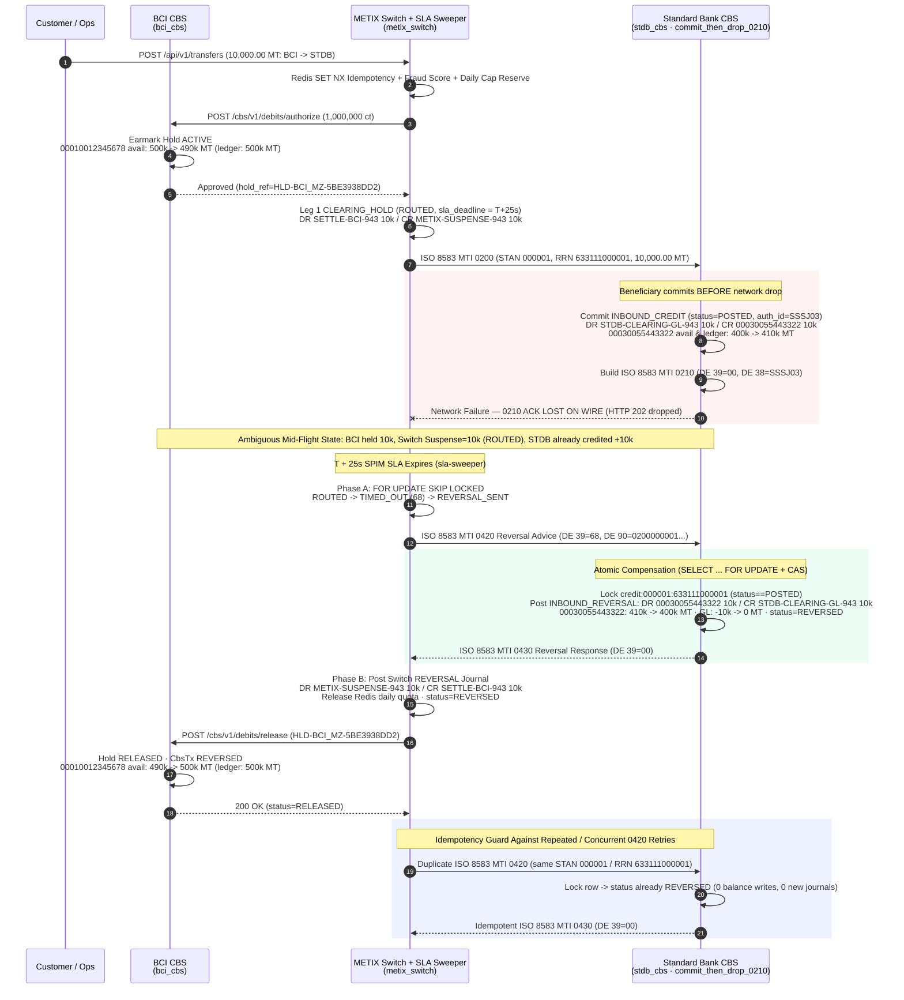

# The Lost Acknowledgment Problem (`commit_then_drop_0210`)

**Topic:** Distributed Transactions, Failure Recovery, and Financial Consistency across Isolated Core Banking Databases (`bci_cbs`, `metix_switch`, `stdb_cbs`).

---

## Overview: `drop_0210` vs. `commit_then_drop_0210`

In an interbank instant payment switch (METIX / SIMOrede under Banco de Moçambique Notice No. 1/GBM/2026), losing an ISO 8583 `0210` Financial Response creates **outcome ambiguity** for the central switch—but the ledger state at the beneficiary bank depends on *where* the failure occurred:

| Chaos Preset | Beneficiary CBS Action on `0200` | Beneficiary Ledger Mid-Flight | Required `0420` Compensation |
| :--- | :--- | :--- | :--- |
| `drop_0210` | Drops message **before** processing credit | Unchanged (`400,000.00 MT`) | Safe no-op (`0430 DE 39 = 00`); only Switch suspense & BCI hold unwind |
| `commit_then_drop_0210` | **Commits** credit (`INBOUND_CREDIT` journal), builds `0210 (00)`, then drops `0210` on the wire | **Credited (`410,000.00 MT`)** while Switch stays `ROUTED` and BCI holds `10,000.00 MT` | Beneficiary CBS must atomically reverse the committed credit (`INBOUND_REVERSAL`), zero its Clearing GL, and ignore repeated/concurrent `0420` retries |

### Scenario Under Analysis
A customer at **BCI** (`00010012345678`, Amélia Machel) initiates a **`10,000.00 MT`** (`1,000,000` centavos) instant transfer to **Standard Bank** (`00030055443322`, Carlos Mondlane) while `STDB_MZ` has chaos preset `commit_then_drop_0210` enabled:

```json
POST /api/v1/banks/STDB_MZ/chaos
{
  "preset": "commit_then_drop_0210",
  "latency_ms": 100
}
```

1. **BCI CBS (`bci_cbs`)** earmarks `10,000.00 MT` (`available_balance` decreases; `ledger_balance` unchanged; `cbs_holds.status = ACTIVE`).
2. **METIX Switch (`metix_switch`)** posts Leg 1 `CLEARING_HOLD` (`DEBIT SETTLE-BCI-943`, `CREDIT METIX-SUSPENSE-943`), transitions to `ROUTED`, and sends ISO 8583 `0200` to Standard Bank.
3. **Standard Bank CBS (`stdb_cbs`)** receives `0200`, commits `INBOUND_CREDIT` (`DEBIT STDB-CLEARING-GL-943`, `CREDIT 00030055443322`), and builds `0210` (`DE 39 = 00`, `DE 38 = SSSJ03`).
4. **Network failure** drops the `0210` response (`HTTP 202 {"dropped": true}`). METIX never receives confirmation.
5. **After 25s SPIM SLA expiry**, `sla-sweeper` transitions `ROUTED -> TIMED_OUT (DE 39 = 68) -> REVERSAL_SENT` and dispatches ISO 8583 `0420` (`DE 90` referencing the original `0200`).
6. **Standard Bank CBS (`stdb_cbs`)** locks `cbs_transactions` with `SELECT ... FOR UPDATE`, verifies `status == POSTED`, executes a deterministic UUID-ordered optimistic-lock CAS (`version` check) to debit `00030055443322` and credit `STDB-CLEARING-GL-943`, persists a balanced `INBOUND_REVERSAL` journal entry, marks the transaction `REVERSED`, and returns `0430` (`DE 39 = 00`).
7. **METIX Switch** posts a balanced `REVERSAL` journal (`DEBIT METIX-SUSPENSE-943`, `CREDIT SETTLE-BCI-943`), releases Redis daily quota, transitions to `REVERSED`, and instructs **BCI CBS** to release the earmark hold (`RELEASED`).
8. **Repeated or concurrent `0420` retries** acquire the row lock, see `status == REVERSED`, perform zero ledger mutations, and return idempotent `0430` (`DE 39 = 00`).

---

## 1. Sequence Diagram of the Failure & Recovery



---

## 2. Observed ISO 8583 Message Trace

Captured from a live execution of the `10,000.00 MT` (`1,000,000` centavos) BCI → Standard Bank transfer (`STAN 000001`, `RRN 633111000001`, `DE 49 = 943`):

| Seq | MTI | Direction (Switch View) | DE 3 (Proc Code) | DE 4 (Centavos) | DE 11 (STAN) | DE 37 (RRN) | DE 38 (Auth ID) | DE 39 (Resp) | DE 90 (Original Data Elements) | Wire Status |
| :---: | :---: | :--- | :---: | :---: | :---: | :---: | :---: | :---: | :--- | :--- |
| 1 | `0200` | `INBOUND` (BCI → METIX) | `280000` | `000001000000` | `000001` | `633111000001` | — | — | — | Logged in `iso8583_message_log` |
| 2 | `0200` | `OUTBOUND` (METIX → STDB) | `280000` | `000001000000` | `000001` | `633111000001` | — | — | — | Logged in `iso8583_message_log` |
| 3 | `0210` | *(Generated at STDB, never received by METIX)* | `280000` | `000001000000` | `000001` | `633111000001` | `SSSJ03` | `00` | — | **DROPPED ON WIRE** (`commit_then_drop_0210`) |
| 4 | `0420` | `OUTBOUND` (METIX → STDB) | `280020` | `000001000000` | `000001` | `633111000001` | — | `68` | `02000000011127110116METIXSWITCHSIMOREDE001` | Logged in `iso8583_message_log` |
| 5 | `0430` | `INBOUND` (STDB → METIX) | `280020` | `000001000000` | `000001` | `633111000001` | — | `00` | `02000000011127110116METIXSWITCHSIMOREDE001` | Logged in `iso8583_message_log` |
| 6 | `0420` / `0430` | Duplicate `0420` Retry → STDB | `280020` | `000001000000` | `000001` | `633111000001` | — | `00` | `02000000011127110116METIXSWITCHSIMOREDE001` | Idempotent no-op (`0430 DE 39 = 00`) |

### Packed ASCII ISO 8583 Wire Frames (`raw_iso_snippet`)

```text
[1] 0200 INBOUND  (BCI -> METIX):
0200F22000000800800000000000060000001400010012345678280000000001000000112711011600000163311100000194321BCI_MZ:0001001234567822STDB_MZ:00030055443322

[2] 0200 OUTBOUND (METIX -> STDB):
0200F22000000800800000000000060000001400010012345678280000000001000000112711011600000163311100000194321BCI_MZ:0001001234567822STDB_MZ:00030055443322

[3] 0210 GENERATED AT STDB (DROPPED ON WIRE — ABSENT FROM metix_switch.iso8583_message_log):
0210F22000000E008000000000000600000014000100123456782800000000010000001127110116000001633111000001SSSJ030094321BCI_MZ:0001001234567822STDB_MZ:00030055443322

[4] 0420 OUTBOUND (METIX sla-sweeper -> STDB, DE 39=68, 42-char DE 90):
0420F22000000A0080000000004006000000140001001234567828002000000100000011271101160000016331110000016894302000000011127110116METIXSWITCHSIMOREDE00121BCI_MZ:0001001234567822STDB_MZ:00030055443322

[5] 0430 INBOUND  (STDB -> METIX, DE 39=00):
0430F22000000A0080000000004006000000140001001234567828002000000100000011271101160000016331110000010094302000000011127110116METIXSWITCHSIMOREDE00121BCI_MZ:0001001234567822STDB_MZ:00030055443322

[6] 0430 REPLAY   (Duplicate 0420 -> STDB, idempotent DE 39=00):
0430F22000000A0080000000004006000000140001001234567828002000000100000011271101160000016331110000010094302000000011127110116METIXSWITCHSIMOREDE00121BCI_MZ:0001001234567822STDB_MZ:00030055443322
```

---

## 3. Before-and-After Account Balances (All 3 Databases)

All amounts are stored as `BIGINT` in centavos (`1.00 MT = 100 centavos`, ISO 4217 `943`). Every optimistic-lock version (`v`) increments strictly on mutation:

| Database | Account | Opening (Before) | Mid-Flight (`ROUTED` · `0210` Dropped) | After `0420`/`0430` Recovery (`REVERSED`) | After Repeated `0420` Retries |
| :--- | :--- | :--- | :--- | :--- | :--- |
| **`bci_cbs`** | `00010012345678` (Amélia Machel) | Avail `500,000.00 MT`<br/>Ledger `500,000.00 MT` (`v1`) | Avail **`490,000.00 MT`** *(earmarked)*<br/>Ledger `500,000.00 MT` (`v2`) | Avail **`500,000.00 MT`**<br/>Ledger `500,000.00 MT` (`v3`) | Avail `500,000.00 MT`<br/>Ledger `500,000.00 MT` (`v3`) |
| **`bci_cbs`** | `BCI-CLEARING-GL-943` | `0.00 MT` (`v1`) | `0.00 MT` (`v1`) | `0.00 MT` (`v1`) | `0.00 MT` (`v1`) |
| **`metix_switch`** | `SETTLE-BCI-943` | `5,000,000.00 MT` (`v1`) | **`4,990,000.00 MT`** (`v2`) | **`5,000,000.00 MT`** (`v3`) | `5,000,000.00 MT` (`v3`) |
| **`metix_switch`** | `METIX-SUSPENSE-943` | `0.00 MT` (`v1`) | **`10,000.00 MT`** (`v2`) | **`0.00 MT`** (`v3`) | `0.00 MT` (`v3`) |
| **`metix_switch`** | `SETTLE-STDB-943` | `5,000,000.00 MT` (`v1`) | `5,000,000.00 MT` (`v1`) | `5,000,000.00 MT` (`v1`) | `5,000,000.00 MT` (`v1`) |
| **`stdb_cbs`** | `00030055443322` (Carlos Mondlane) | Avail `400,000.00 MT`<br/>Ledger `400,000.00 MT` (`v1`) | Avail **`410,000.00 MT`** *(committed!)*<br/>Ledger **`410,000.00 MT`** (`v2`) | Avail **`400,000.00 MT`**<br/>Ledger **`400,000.00 MT`** (`v3`) | Avail `400,000.00 MT`<br/>Ledger `400,000.00 MT` (`v3`) |
| **`stdb_cbs`** | `STDB-CLEARING-GL-943` | `0.00 MT` (`v1`) | **`-10,000.00 MT`** (`v2`) | **`0.00 MT`** (`v3`) | `0.00 MT` (`v3`) |

> **Conservation of Money Verified:** Across all 3 databases, customer balances, clearing GLs, settlement accounts, and `METIX-SUSPENSE-943` return to their exact opening values, Redis daily limits return to `0`, and 3-way reconciliation reports **0 exceptions**.

---

## 4. Database Journal Entries & Hold Lifecycle

### 4.1 `metix_switch` (`journal_entries` & `journal_postings`)

| Entry # | `entry_type` | Description | Account | Direction | Amount (Centavos) | Amount (MZN) |
| :---: | :--- | :--- | :--- | :---: | ---: | ---: |
| 1 | `CLEARING_HOLD` | `Clearing hold for STAN 000001 (BCI_MZ:00010012345678 -> STDB_MZ:00030055443322)` | `SETTLE-BCI-943` | `DEBIT` | `1,000,000` | `10,000.00 MT` |
| 1 | `CLEARING_HOLD` | *(balanced leg)* | `METIX-SUSPENSE-943` | `CREDIT` | `1,000,000` | `10,000.00 MT` |
| 2 | `REVERSAL` | `SPIM 25s SLA timeout reversal (0420/0430) for STAN 000001` | `METIX-SUSPENSE-943` | `DEBIT` | `1,000,000` | `10,000.00 MT` |
| 2 | `REVERSAL` | *(balanced leg)* | `SETTLE-BCI-943` | `CREDIT` | `1,000,000` | `10,000.00 MT` |

- **Trial Balance:** `SUM(DEBIT) = 2,000,000 ct == SUM(CREDIT) = 2,000,000 ct` (`is_balanced = true`, `suspense_balance_centavos = 0`).

### 4.2 `stdb_cbs` (`cbs_transactions`, `cbs_journal_entries` & `cbs_journal_postings`)

`cbs_transactions` row `CBS-STDB_MZ-58A707358F` (`idempotency_key = "credit:000001:633111000001"`, `tx_type = "INBOUND_CREDIT"`, `auth_id = "SSSJ03"`):
- Transitions **`POSTED` → `REVERSED`** atomically under `SELECT ... FOR UPDATE` on the first `0420`.
- Subsequent sequential or concurrent `0420` deliveries observe `status == "REVERSED"` and create **zero** additional journal entries.

| Entry # | `entry_type` | Description | Account | Direction | Amount (Centavos) | Amount (MZN) |
| :---: | :--- | :--- | :--- | :---: | ---: | ---: |
| 1 | `INBOUND_CREDIT` | `Inbound interbank credit STAN 000001 from BCI_MZ` | `STDB-CLEARING-GL-943` | `DEBIT` | `1,000,000` | `10,000.00 MT` |
| 1 | `INBOUND_CREDIT` | *(balanced leg)* | `00030055443322` | `CREDIT` | `1,000,000` | `10,000.00 MT` |
| 2 | `INBOUND_REVERSAL` | `Reversal (0420) of inbound credit STAN 000001` | `00030055443322` | `DEBIT` | `1,000,000` | `10,000.00 MT` |
| 2 | `INBOUND_REVERSAL` | *(balanced leg)* | `STDB-CLEARING-GL-943` | `CREDIT` | `1,000,000` | `10,000.00 MT` |

- **Trial Balance:** `SUM(DEBIT) = 2,000,000 ct == SUM(CREDIT) = 2,000,000 ct`, `STDB-CLEARING-GL-943 = 0.00 MT`.

### 4.3 `bci_cbs` (`cbs_holds` & `cbs_transactions`)

Because BCI only earmarks `available_balance_centavos` during `authorize_debit` and never mutates `ledger_balance_centavos` until `capture_debit`, releasing the hold restores `available_balance_centavos` without touching `BCI-CLEARING-GL-943`:

| Table | Reference | Mid-Flight State | Post-`0430` State |
| :--- | :--- | :---: | :---: |
| `cbs_holds` | `HLD-BCI_MZ-5BE3938DD2` (`1,000,000 ct`) | `ACTIVE` | `RELEASED` |
| `cbs_transactions` | `CBS-BCI_MZ-6CE8D99E3F` (`OUTBOUND_DEBIT`) | `HELD` | `REVERSED` |

---

## 5. Verification Coverage

Covered by automated 3-database integration tests in [`backend/tests/test_switch_integration.py`](../backend/tests/test_switch_integration.py):
- `test_7_commit_then_drop_0210_lost_ack_compensates_across_all_three_dbs`: End-to-end `10,000.00 MT` BCI → Standard Bank test verifying mid-flight committed credit in `stdb_cbs`, active hold in `bci_cbs`, suspense in `metix_switch`, automated `>25s` SLA `0420`/`0430` compensation across all 3 DBs, sequential + concurrent `0420` replay idempotency, and zero 3-way reconciliation exceptions.
- `test_8_concurrent_0420_race_and_wallet_commit_then_drop`: Simultaneous `5×` `0420` race against an un-reversed `POSTED` credit (verifying `SELECT ... FOR UPDATE` produces exactly 1 `INBOUND_REVERSAL` journal entry and zero double-reversal) plus `commit_then_drop_0210` parity on the Redis-backed mobile wallet simulator (`MPESA_MZ`).
